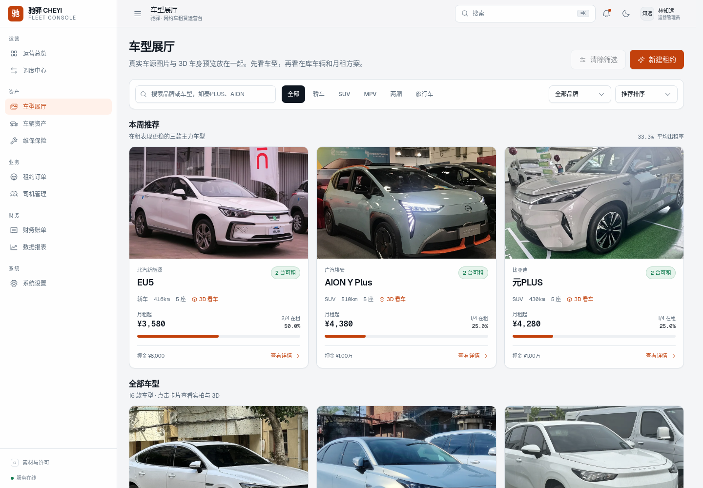
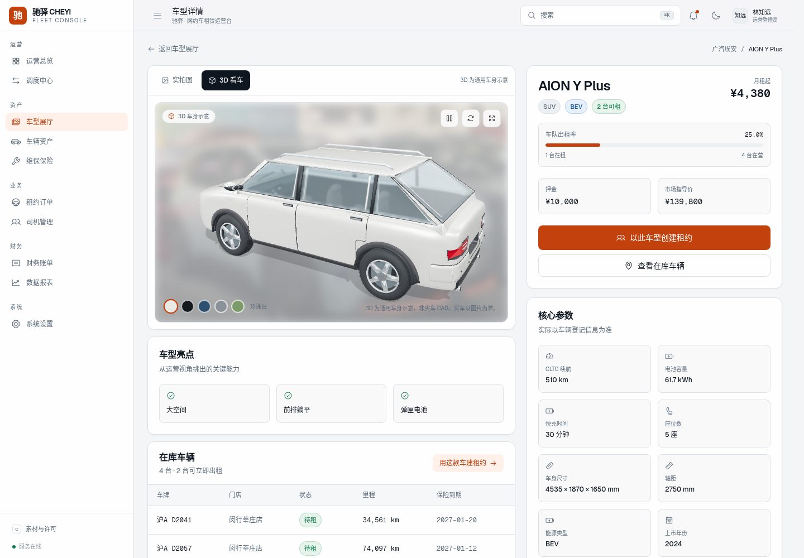
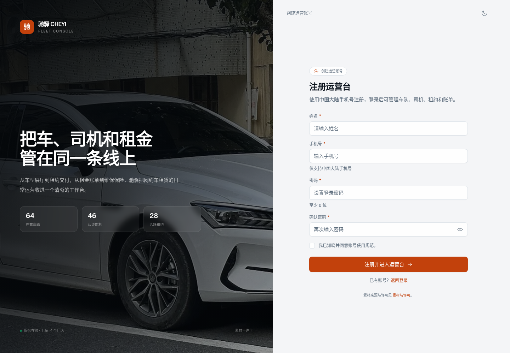
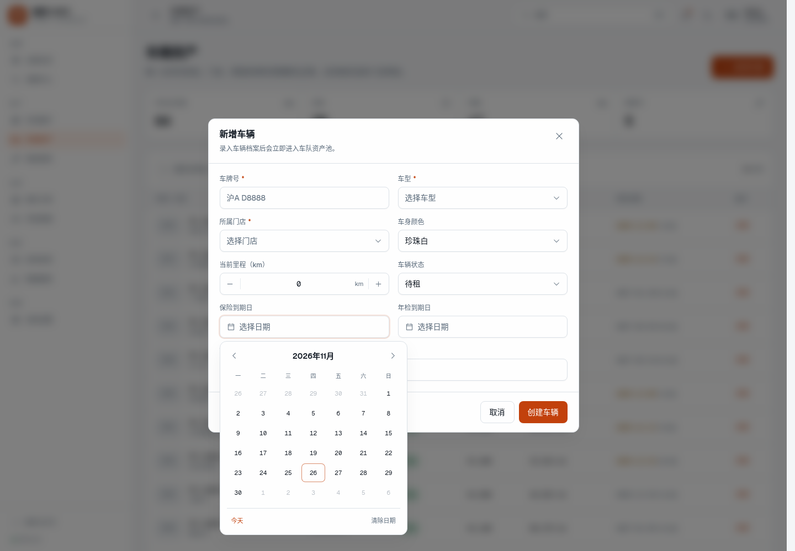
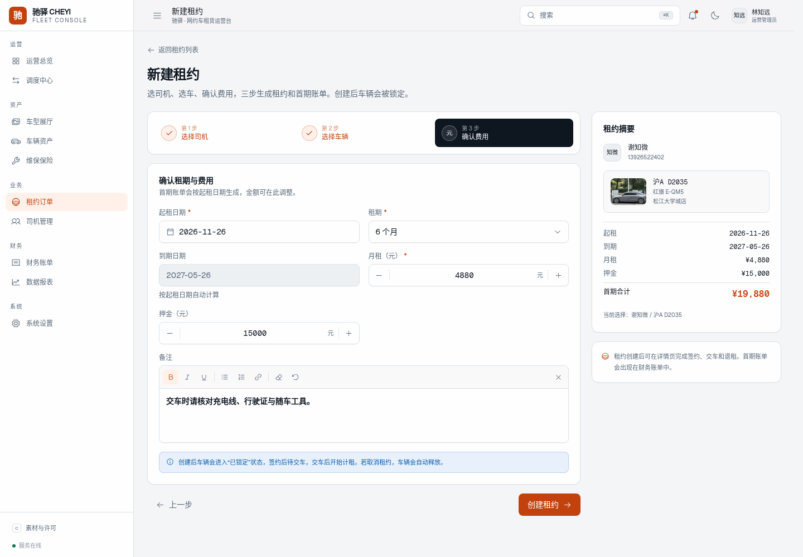
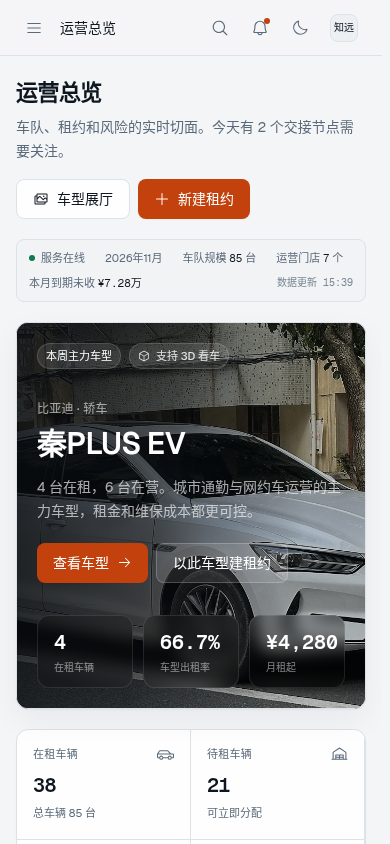

# 驰驿 CHEYI · 网约车租赁运营台

面向网约车租赁公司的 B 端运营系统。围绕“车队租给司机跑网约车”的真实业务，把车辆资产、车型展厅、租约、司机、调度、维保保险、租金账单和数据报表收进一个工作台。

> 页面不维护业务数据副本：门店、车辆、司机、租约、账单等均通过 `frontend/src/api` 请求后端，由后端从 `backend/data/cheyi.db` 读取。

## 预览














更多截图见 `docs/previews/`。

## 快速开始

环境要求：

- Node.js 20+
- Go 1.26+
- npm 10+

```bash
./start.sh
```

默认启动开发模式，依赖就绪后自动打开浏览器；首次运行会自动安装前端依赖。

- 前端：http://localhost:5174
- 后端：http://localhost:8090
- 管理员账号：`123 8888 8888` / `Cheyi@2026`

其他启动方式：

```bash
./start.sh --no-open     # 启动但不打开浏览器
./start.sh --prod        # 构建后以生产单端口启动
./start.sh --build       # 只构建，不启动
make dev                 # 兼容原有开发脚本
```

端口可通过 `BACKEND_PORT` / `FRONTEND_PORT` 覆盖，Vite 代理会同步到后端端口。

数据库固定存放在 `backend/data/cheyi.db`，基准运营数据随仓库提交；首次启动时会自动建表并补种缺失数据。重置数据：

```bash
make reset-db
```

## 文档

- [01 Brainstorming 纪要](docs/01-brainstorming-纪要.md)
- [02 PRD](docs/02-PRD.md)
- [03 交互设计](docs/03-交互设计.md)
- [04 技术方案与 API](docs/04-技术方案与API.md)
- [05 代码拆分与目录结构](docs/05-代码拆分与目录结构.md)
- [06 自研表单控件与 UI 优化](docs/06-UI组件与设计优化.md)
- [07 样式复用与一致性审计](docs/07-样式复用与一致性审计.md)
- [08 布局复用与 API 分层](docs/08-布局复用与API分层.md)
- [09 手机号认证与交互组件](docs/09-手机号认证与交互组件.md)
- [10 前后端拆分方案与文件结构](docs/10-前后端拆分方案与文件结构.md)
- [12 性能优化与 Toast 体系](docs/12-性能优化与Toast体系.md)

## 功能模块

| 模块 | 路由 | 能力 |
|---|---|---|
| 登录 / 注册 | `/login` `/register` | 手机号登录、号段校验、注册后自动登录 |
| 运营总览 | `/` | 大幅车型主视觉、KPI、营收趋势、车队结构、交接、风险、门店运力、热门车型、最近租约 |
| 车型展厅 | `/models` | 16 款车型、实拍图、筛选排序、3D 看车入口 |
| 车型详情 | `/models/:slug` | 实拍图与 3D 车身、参数、价格、在库车辆、相关车型 |
| 车辆资产 | `/vehicles` | 筛选、分页、新增、车辆档案、租约/维保/保险/违章 |
| 租约订单 | `/leases` | 状态标签、筛选、新建租约三步向导、签约/交车/退租/取消 |
| 司机管理 | `/drivers` | 认证状态、当前车辆、租约历史、账单、违章、证件 |
| 调度中心 | `/dispatch` | 门店库存矩阵、车辆池、跨店调拨、完成调拨 |
| 维保保险 | `/maintenance` | 保养/维修/年检工单、状态推进、保险到期 |
| 财务账单 | `/finance` | 待收/已收/逾期/押金、收款、生成月租、CSV、违章处理 |
| 数据报表 | `/reports` | 出租率、收入、车型贡献、门店排行、维保成本 |
| 系统设置 | `/settings` | 门店、价格方案、账号安全、提醒规则 |
| 素材与许可 | `/credits` | 图片与 3D 模型来源、许可证、使用边界 |

## 技术栈

- 前端：React 19、Vite 8、TypeScript、Tailwind CSS v4、React Router 7、TanStack Query 5、React Hook Form、Zod、Phosphor Icons、Three.js
- 后端：Go、Gin、GORM、SQLite（纯 Go 驱动）、JWT HttpOnly Cookie、bcrypt
- 主题：亮/暗双主题，语义化 CSS 变量，View Transitions 左下角圆形扩散切换（700ms）
- 表单：自研 Select / DatePicker / NumberInput / SearchInput / RichTextEditor，无 UI 组件库；下拉与日历使用 portal、键盘导航和焦点管理
- 3D：Innerscene CC0 通用车身 GLB，按车身类型映射，支持旋转、颜色切换、全屏
- 构建：开发双端口，生产把前端 `dist` 嵌入 Go 二进制

## 生产构建

```bash
make build
APP_ENV=production PORT=8090 DB_PATH=backend/data/cheyi.db ./backend/cheyi-server
```

打开 http://localhost:8090，前端与 API 同端口。

## 测试

```bash
make test
```

- Go：密码/JWT 单元测试、种子数据集成测试
- 前端：金额、日期、状态标签、错误文案工具测试

## 目录

```text
cheyi-fleet-console/
├── docs/                 01 纪要、02 PRD、03 交互、04 API、05 代码拆分、06 UI 组件、07 一致性审计、08 API 分层、09 手机号认证、10 拆分方案
├── backend/
│   ├── cmd/server/       Go 入口
│   ├── internal/
│   │   ├── models/       按领域拆分的 GORM 模型
│   │   ├── database/     连接、迁移、按域拆分的种子数据
│   │   ├── handler/      按用例拆分的 HTTP handler
│   │   ├── auth/         JWT 与密码
│   │   ├── middleware/   认证与 CORS
│   │   ├── router/       路由
│   │   └── web/          前端嵌入
│   └── data/             SQLite
├── frontend/
│   ├── src/api/          按领域拆分的 API 请求函数
│   ├── src/types/        按领域拆分的 TypeScript 类型
│   ├── src/hooks/        全局 hooks
│   ├── src/components/   ui、charts、layout、three、domain
│   ├── src/pages/        按页面拆分的页面、子组件与页面 hooks
│   └── public/           车型图片、场景图、3D GLB、credits.json
├── .gitignore            按依赖/构建/数据/环境分区忽略
├── .dockerignore         容器构建上下文分区忽略
├── start.sh              一键启动、自动打开浏览器、支持 dev/prod/build
├── scripts/dev.sh        兼容原有开发双端口启动
├── scripts/start-helpers.sh  start.sh 共享函数
├── Makefile
├── ASSETS.md             素材来源与许可
└── README.md
```

更细的拆分清单见 `docs/05-代码拆分与目录结构.md`。

## 说明

- 车型图片来自 Wikimedia Commons，3D 模型来自 Innerscene，场景图片来自 Unsplash，详见 `/credits` 与 `ASSETS.md`。
- 3D 模型是通用车身示意，不是具体车型 CAD。
- 车型参数、租金、司机与车辆数据均为系统数据。
- 当前环境不接支付、地图、短信、电子合同、发票和真实文件上传。
- 商用前请替换为已授权的官方素材，并核对车型配置与价格。