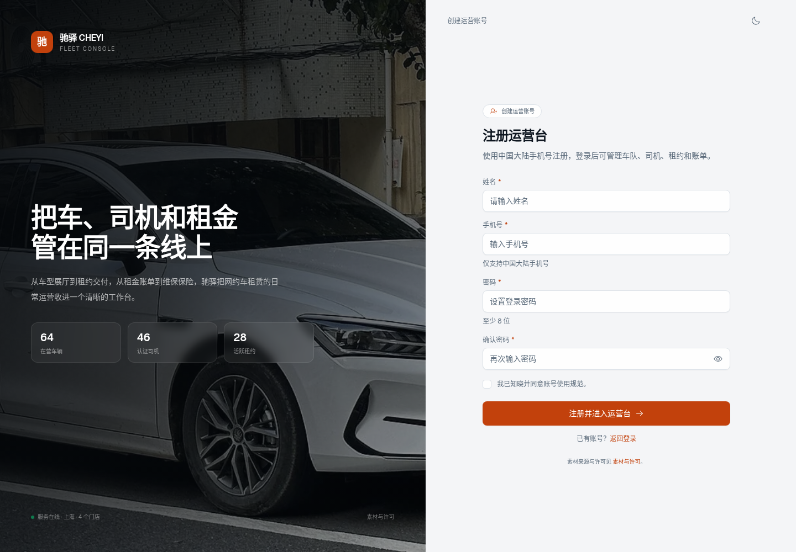
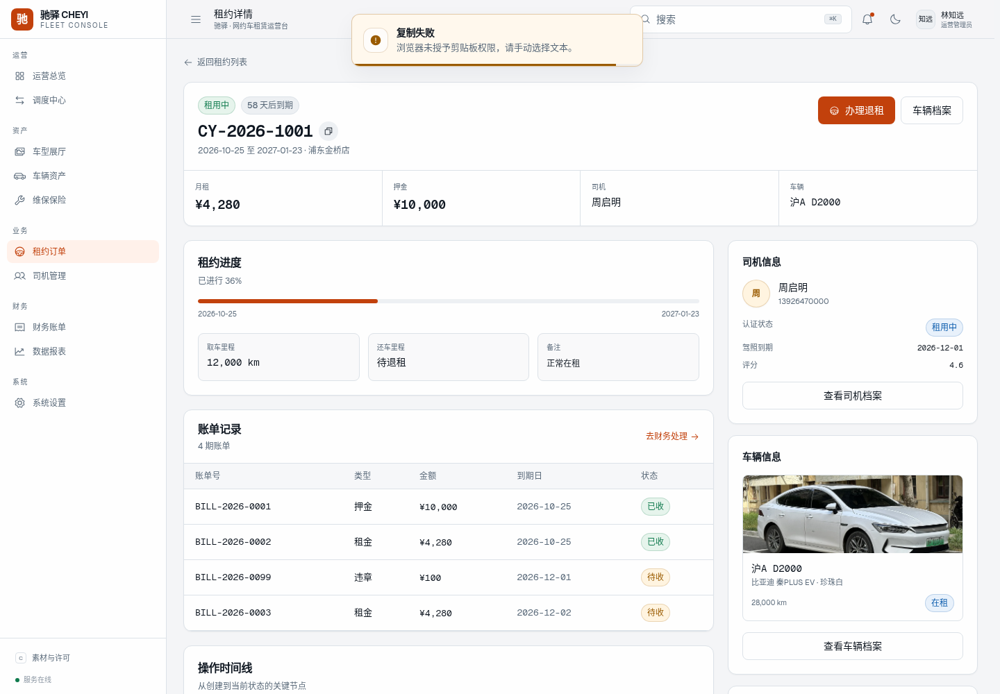

# 09 · 手机号认证与交互组件升级

> 日期：2026-11-26
> 范围：登录、注册、手机号校验、按钮对齐、清空按钮、Checkbox、Toast、复制
> 约束：手机号登录、仅真实号段可注册、Web 服务保持运行

---

## 1. 手机号登录与注册

### 1.1 登录

- 登录账号使用中国大陆手机号。
- 支持输入 `12388888888`、`123 8888 8888`、`+86 139...`、`0086 139...`。
- 登录只校验 11 位、1 开头；预置管理员账号可使用非真实号段。
- 注册必须通过真实运营商号段校验。
- 后端统一归一化为 11 位手机号后查询。
- 登录失败统一返回“手机号或密码不正确”。
- 管理员账号：`123 8888 8888` / `Cheyi@2026`。

### 1.2 注册

- 新增 `/register` 注册页。
- 字段：姓名、手机号、密码、确认密码、账号使用规范确认 Checkbox。
- 注册成功后自动建立 Cookie 会话并进入运营台。
- 注册账号角色为 `operator`，账号信息只包含姓名与手机号。
- 重复手机号返回 409，弱密码（少于 8 位）返回 400。
- 设置页修改手机号时校验格式与唯一性；管理员允许 11 位 1 开头的预留号，运营账号要求真实号段。

### 1.3 中国大陆手机号段识别

前后端各自实现同一套号段规则：

- 中国移动：134-139、147、150-152、157-159、172、178、182-184、187-188、195、197、198
- 中国联通：130-132、145、155-156、166、175-176、185-186、196
- 中国电信：133、149、153、173、177、180-181、189-191、193、199
- 中国广电：192
- 虚拟运营商：162、165、167、170、171

验证规则：

- 注册：11 位数字，`1[3-9]` 开头，且号段必须在上表中。
- 登录：11 位、1 开头；预置管理员 `12388888888` 为例外。
- 注册时未知号段、长度错误、`140`/`123` 等开头一律拒绝。
- 前端显示“已识别：中国移动/中国联通/中国电信/中国广电/虚拟运营商”。
- 当前未接短信验证码，号段校验只能证明号码格式与运营商归属，不能证明号码实际持有；如上线真实业务，应补充短信验证。

---

## 2. 按钮高度与垂直居中

- `Button` / `ButtonLink` 基础样式增加 `leading-none` 和 `[&>svg]:shrink-0`。
- `Tabs`、`Select`、`DatePicker`、Topbar 搜索等图标+文字控件补充 `leading-none`。
- 保留整数高度：`h-8` 32px、`h-9` 36px、`h-10` 40px、`h-11` 44px、`h-12` 48px。
- 全路由 Playwright 审计：
  - 0 个按钮出现小数高度
  - 0 个按钮图标中心与按钮中心偏移超过 0.75px

---

## 3. 圆形清空按钮

统一清空按钮形状为 `rounded-full`（不是 `rounded-md` / `rounded-lg`）：

| 组件 | 行为 |
|---|---|
| `Input` | 有值时显示圆形清空按钮；密码框不显示清空按钮，只保留显示/隐藏密码 |
| `Textarea` | 右上角圆形清空按钮 |
| `SearchInput` | 圆形清空按钮 |
| `RichTextEditor` | 工具栏右侧圆形清空按钮，清空后聚焦编辑器 |

- 清空按钮尺寸 24×24，`rounded-full`，`aria-label` 明确。
- `readOnly` / `disabled` / `type=password` 输入不显示清空按钮。
- RHF 非受控输入通过原生 `input` 事件同步清空，兼容登录表单。

---

## 4. Checkbox

- 重做 `Checkbox`：隐藏原生 input + 自定义视觉方框。
- 支持 `checked`、`disabled`、`label`、`description`、`id`、`className`。
- 焦点通过 `peer-focus-visible` 显示 accent ring。
- 已用于注册页“我已知晓并同意账号使用规范”确认项。

---

## 5. Toast

- Toast 从页面顶部出现，容器固定在 `top-0`，层级 `z-[120]`，覆盖 Topbar 而不是从 Topbar 下方出现。
- 新的顶部 Toast 结构：
  - 12px 圆角、语义边框与 `shadow-card`
  - 语义纯色柔和表面（success / error / warning / info，使用 color-mix 与 card 融合）
  - 圆角方形语义图标，与标题/描述整体垂直居中
  - 标题 / 描述
  - 不使用关闭按钮，4.2 秒后自动消失
  - 底部 4.2 秒进度轨
  - 顶部滑入动画
  - 定时器在 Provider 卸载时清理
- 成功/错误/警告/信息四种语义色；错误使用 `role="alert"` / `aria-live="assertive"`。
- 跨字段校验、步骤校验和账号勾选校验统一使用 warning Toast；zod 字段校验同时保留 inline error。

---

## 6. 复制

新增 `lib/clipboard.ts` 和 `CopyButton`：

- 优先使用 `navigator.clipboard.writeText`（HTTPS / localhost / secure context）。
- 在 HTTP 非安全上下文或 Clipboard API 不可用时回退到 `textarea + document.execCommand('copy')`。
- 复制按钮为圆形图标按钮，复制成功后显示对勾。
- 已用于租约详情复制租约号。

---

## 7. 验证

| 项目 | 结果 |
|---|---|
| 后端 `go test ./...` | 通过（phone / database / auth） |
| 前端 `npm test -- --run` | 10 项通过 |
| `npx tsc -b` | 通过 |
| 手机号登录 | 通过 |
| 注册新账号并自动登录 | 通过 |
| 重复手机号 / 无效号段 | 返回 409 / 400 |
| 全路由按钮小数高度 | 0 处 |
| 全路由图标偏移 > 0.75px | 0 处 |
| 输入框/搜索框/Textarea/富文本清空 | 通过；密码框不显示清空 |
| Toast 顶部位置 | y=20，覆盖 Topbar |
| 步骤/弹窗校验 Toast | 通过（如“请先选择一位司机”） |
| 筛选控件高度 | 40px |
| 表单控件高度 | 44px |
| 下拉选项 gap / 账号菜单 gap | 4px / 4px |
| Toast 尺寸 | 420 × 76px（带描述） |
| Toast 纯色表面 / 阴影 / 进度轨 | 通过 |
| Toast 无关闭 X / 无状态标签 | 通过 |
| 主滚动条上下箭头 | 无 |
| 主题切换滚动条颜色 | 扩散结束后更新 |
| Toast 图标与文字垂直居中 | 通过 |
| 复制失败 Toast | 显示 warning 提示 |
| 租约号复制 | 剪贴板内容正确 |
| 服务状态 | 前端 5174 / 后端 8090 持续运行 |

---

## 8. 忽略文件

`.gitignore` 与 `.dockerignore` 均按用途分区，并带中文注释：

- 依赖
- 前端构建产物
- 后端构建与嵌入资源
- 数据库与运行时数据
- 环境变量与密钥
- 日志、缓存与测试产物
- 编辑器与系统文件
- 本地临时文件 / 容器构建文件

`.dockerignore` 额外排除 `.git/`、文档、预览截图、启动脚本和容器编排文件，保持镜像构建上下文干净。

---

## 9. 筛选栏与顶栏对齐修复

- 顶栏搜索框高度 40px，响应式宽度：`w-56` / `lg:w-72` / `xl:w-80`；搜索图标、文案和快捷键在同一行居中。
- 顶栏所有按钮、通知、主题、账号菜单和搜索入口统一 `cursor: pointer`；禁用态保持禁用光标。
- 紧凑筛选场景统一高度 **40px**：
  - `SearchInput size="sm"`
  - `Select size="sm"`
  - `DatePicker size="sm"`
  - `Tabs` 默认高度 40px
  - 分页每页条数与翻页按钮统一 40px
- 表单/弹窗场景统一 **44px** 高度；`SearchInput size="lg"` 为 48px；Textarea 最小高度 112px。
- 搜索宽度：司机/车型/租约/财务 320px，车辆 288px；筛选下拉 144–160px；报表日期 176px。
- `DatePicker` 日历浮层宽度 **340px**。
- `Select` 浮层最小宽度 240px，选项行高 40px，选项之间 gap 4px。
- 用户账号菜单最小宽度 192px，菜单项之间 gap 4px。
- 下拉触发器移除 `leading-none`，选项统一 `leading-5`；文字不再被上下裁切。
- 紧凑搜索/下拉/日期/数字输入字号统一 14px；不再使用 12px 小字。
- Select / DatePicker 在 portal 内聚焦统一使用 `preventScroll: true`，打开下拉不再把页面滚动条拉到底部。
- 主滚动条宽 8px、品牌 accent 橙色系；内部 `scrollbar-thin` 宽 8px、info 蓝色半透明；二者独立；`::-webkit-scrollbar-button` 设为 `display:none`，全项目滚动条无上下箭头。
- 主题扩散期间冻结滚动条变量，扩散完成后再切换滚动条颜色；恢复 root View Transition，扩散动画保持 700ms 从左下角展开。
- 司机详情统计改为 Card 全宽通栏，分隔线不再被圆角背景截断。
- 下拉、日期、Tab 的图标与文字使用 `flex + items-center`，图标中心与文字中心偏差为 0。
